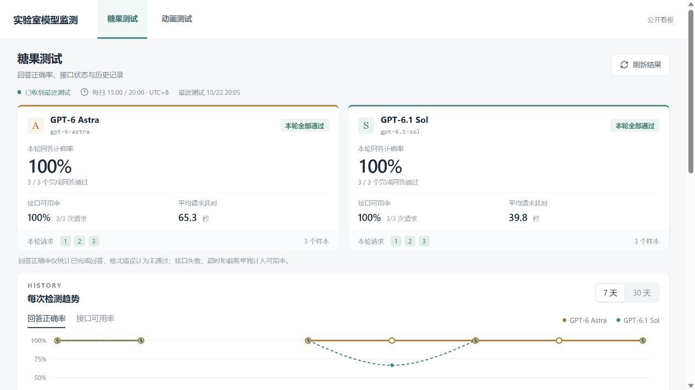
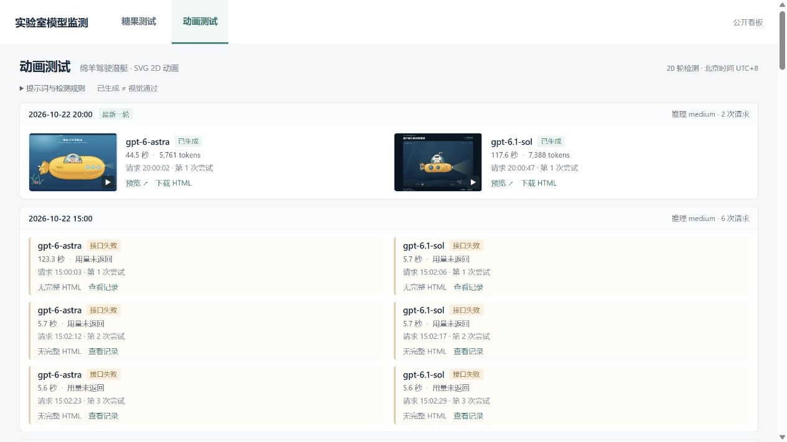

# Lab Model Monitor · 实验室模型监测

LLM behavior & API availability monitoring, with a local console and a public dashboard.

记录模型 API 的可用性、响应耗时与固定任务表现，提供 Windows 本地控制台和公开结果看板。

糖果测试是一道答案为整数的固定题目，按首行整数自动判分，看板展示回答正确率、接口状态与历史记录；动画测试让模型用 SVG 写一段 2D 动画网页，看板展示生成的 HTML、预览和可下载作品。本地控制台用于配置模型、管理检测计划和查看原始回答。

[查看糖果看板](https://kevin-lab-model-monitor.kevinjiang1018.chatgpt.site/) · [查看动画与作品](https://kevin-lab-model-monitor.kevinjiang1018.chatgpt.site/animations) · [本地运行检测](#本地运行检测) · [网站开发与部署说明](docs/operations.md#网站开发与部署)



*公开演示站截图，摄于 2026-10-23；画面中的模型名、分数和时间仅代表当时的实验记录。*

<details>
<summary>查看动画测试：作品与失败记录并列保留</summary>



*同日公开站截图；生成成功与失败尝试均按原始记录展示。*

</details>

结果用于观察所配置端点在固定任务下的表现；模型名称与单题成绩不能认证后端模型身份，也不能代表整体能力。

## 能做什么

- **固定任务检测**：糖果题自动判分；动画保留原始 HTML，提供缩略图、隔离预览、源码与下载。
- **运行记录**：SQLite 保存原始回答、运行 ID、时间、耗时、用量与执行参数合同，按相同合同汇总比较；答错、接口失败、超时与不完整回答分别记录。
- **本地管理与交付**：配置模型与计划，查看流式进度、历史样本，暂停后续计划或停止当前手动任务；可选飞书摘要和网页同步，交付失败后从既有证据重试，不重复调用模型。

## 本地运行检测

以下步骤用于全新克隆，需要 **Windows** 和 **Python 3.12+**；仅运行检测无需安装 Node.js。已有本机配置时，通过控制台修改，跳过示例配置复制步骤。

```powershell
git clone https://github.com/KevinJiang05/lab-model-monitor.git
cd lab-model-monitor
py -3.12 -m venv .venv
New-Item -ItemType Directory -Path runtime -Force | Out-Null
Copy-Item configs\settings.example.json runtime\settings.json
.venv\Scripts\python.exe scripts\start_console.py
```

也可以双击根目录的 `启动控制台.cmd`。控制台地址为 `http://127.0.0.1:18765/`；Python 无第三方运行依赖。

克隆、安装和打开控制台不会发起模型采样，也不会安装检测计划。配置自己的端点、模型名和密钥后，手动启动检测或启用计划才会发出模型请求并消耗 API 额度；费用与支持的模型/参数由该端点决定。示例中的自动计划和飞书均关闭，网站同步地址为空。

仅在本地检测时保持飞书与网站同步关闭，需要时再配置自己的渠道与凭据。真实凭据只通过控制台、隐藏输入脚本或环境变量配置，详见[本机使用说明](docs/operations.md#本机使用)。作者演示部署使用 UTC+8 每日 15:00 / 20:00，这不是克隆后的自动任务。

## 测试方法与结果含义

标准糖果题 `candy-shape-selection-v1` 明确允许凭手感选择形状、不能选择口味，要求首行整数，参考答案为 **21**。题面与判分合同固定；本地自定义整数题采用独立合同，不混入公开糖果看板。

回答正确率与接口可用率分别统计：接口失败、超时与不完整回答不计作答错；格式错误作为独立状态记录，计入已完成回答的未通过结果。

动画任务要求生成“SVG 绘制一个绵羊驾驶潜艇的 2D 动画”的完整 HTML。`generated` 表示收到了符合交付格式的作品，不表示视觉质量通过。

这是个人实验项目。页面中的模型名来自本地配置与 API 返回声明，均不能证明后端身份。本项目不隶属于模型厂商，不构成官方评测或服务承诺。

## 工作方式

```text
Windows 计划任务 / 本地控制台
          │
          ▼
Python 检测入口 ──► 配置的模型 API
          │
          ▼
本地 SQLite：原始回答、合同与交付状态
          │
          ├──► 原始 HTML 与缩略图
          ├──► 飞书摘要（可选）
          └──► Sites D1：有界展示副本 ──► 公开看板
```

Python 端仅使用标准库，本地数据库是原始证据的唯一活动来源。`run`、`animation`、`run-all` 会调用模型；`sync` 只处理已有结果、补齐缩略图并重试交付。React 网站展示 D1 中的有界副本，不持有模型 API 密钥，也不执行采样。

## 开发与验证

网站开发另需 **Node.js 22.13+** 和 npm。安装、首次本地 D1 建表、预览与独立部署前提见[网站开发与部署说明](docs/operations.md#网站开发与部署)。

```powershell
.venv\Scripts\python.exe -m unittest discover -s tests -v
node node_modules/typescript/bin/tsc --noEmit
npm run lint
npm run test:site
npm run build
```

现有回归测试使用临时存储与模拟请求，覆盖题目下界、失败分类、流式中断、合同隔离、调度去重、通知与同步，以及控制台操作。不要用真实模型请求代替测试。

| 路径 | 职责 |
| --- | --- |
| `lab_model_monitor/` | 检测、流式客户端、SQLite、交付与本地控制台 |
| `app/`、`lib/` | React 网站、结果展示与数据合同 |
| `db/`、`drizzle/` | D1 展示副本与迁移 |
| `scripts/`、`build/` | 启动、调度、导出与 Sites 构建适配 |
| `tests/`、`configs/` | 回归测试与不含凭据的配置示例 |
| `runtime/` | 本机配置、凭据、数据库、日志与生成物，全部忽略提交 |

详细行为、命令与回退限制见[操作与数据合同](docs/operations.md)；最初拆分经过见[历史迁移记录](docs/migration.md)。

## 许可与来源

本项目从已有量化项目的模型检测功能拆分，网站沿用 Sites scaffold 与构建适配。

项目原创代码按 [MIT](LICENSE) 许可发布。第三方适配源码、依赖与模型生成作品的来源及边界见 [THIRD_PARTY_NOTICES.md](THIRD_PARTY_NOTICES.md)。
